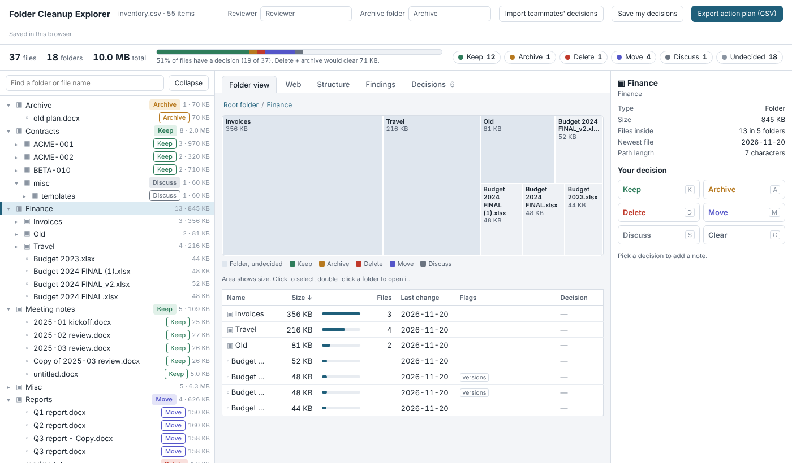
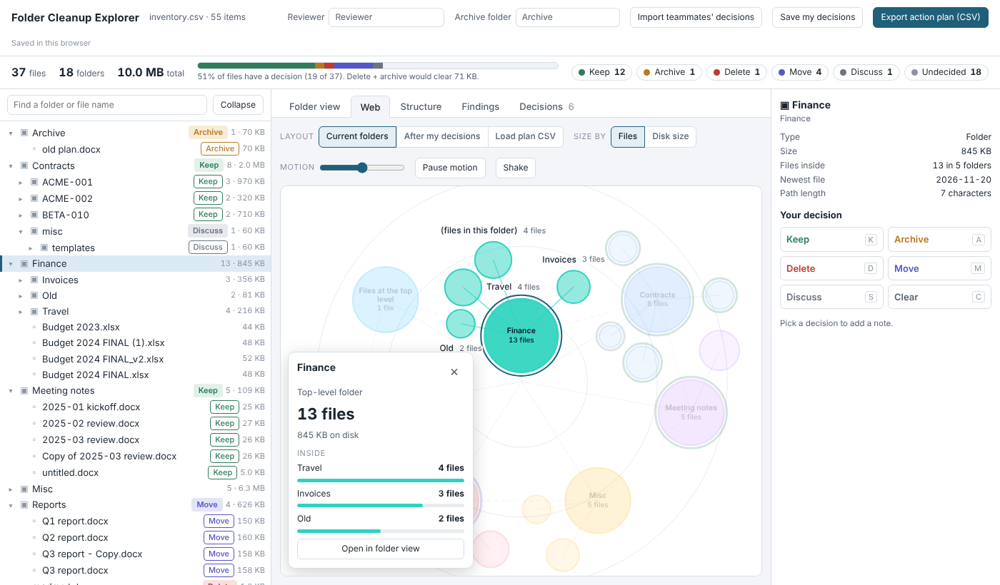
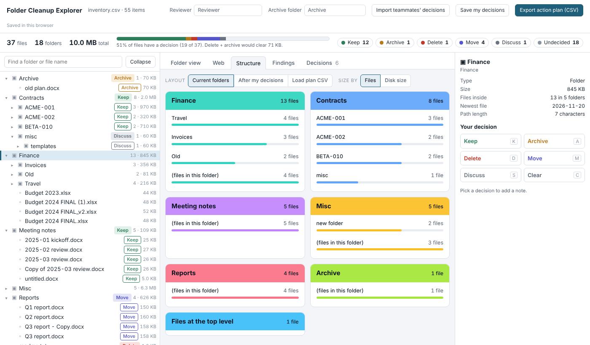

# File Cleanup Tool

Review a messy folder visually with your team, agree on a cleaner structure, and copy it into a new
folder. Your original files are never moved, renamed or deleted.

Built for shared document libraries (SharePoint and OneDrive sync folders, network drives), where several
people need to agree on where things should go before anything changes.

- **Standard library only.** No `pip install` of third-party packages, no network, no accounts.
- **Offline explorer.** One HTML file that shows your folders as a tree, a bubble map, and cards. Everyone reviews in a browser.
- **Decisions, not guesses.** Mark any folder or file Keep, Archive, Delete, Move (with a new location) or Discuss. Teammates export their decisions and the lead merges them.
- **Safe copy.** Dry run first. Then files are copied (never moved), sizes are verified, every result is logged, and a stopped run can be resumed.
- **Rules for a first draft.** Describe the structure you want in a small JSON file and get a plan without clicking through thousands of files.

## What it looks like

The explorer is one offline HTML file. Review the tree and treemap, see the folders as a bubble map or as cards, and mark anything Keep, Archive, Delete, Move or Discuss.



| Web: draggable bubbles sized by file count | Structure: the same folders as cards |
|---|---|
|  |  |

(Screenshots use the built-in practice folder from `file-cleanup demo`.)

## Install

Python 3.9 or newer.

```
pip install git+https://github.com/cnote203/File_Cleanup_Tool.git
file-cleanup --version
```

No network, or `pip` is blocked? Download the repository and run it in place:

```
python file_cleanup.py --version
```

(`python -m file_cleanup_tool` works too, from the `src` folder.)

## Try it in two minutes

```
file-cleanup demo practice            # makes a messy sample folder
file-cleanup explore practice         # scans it and opens the explorer in your browser
```

In the explorer, select folders and press Keep, Archive, Delete, Move or Discuss. When you are done, choose
**Export action plan (CSV)**. Then copy into a new folder:

```
file-cleanup apply --src practice --dest practice_new --plan cleanup_action_plan.csv          # dry run
file-cleanup apply --src practice --dest practice_new --plan cleanup_action_plan.csv --go     # copy
```

## Commands

| Command | What it does |
|---|---|
| `demo [PATH]` | Create a messy practice folder. |
| `scan PATH [--out inventory.csv]` | Write a CSV listing every file and folder. Read-only. |
| `explore PATH [--plan PLAN.csv] [--no-open]` | Scan, then build `cleanup-output/explorer.html` and open it. |
| `suggest --rules RULES.json [--inventory inventory.csv] [--out suggested_plan.csv]` | Draft a plan from rules. See [docs/rules.md](docs/rules.md). |
| `apply --src OLD --dest NEW --plan PLAN.csv [--undecided keep] [--go]` | Copy files into the new structure. Dry run unless `--go`. |

### What `apply` copies

It reads the explorer's exported plan or a plain mapping sheet (see [docs/plan-format.md](docs/plan-format.md)).

- **Copied:** Move, Archive and Keep.
- **Left out:** Delete, Discuss and undecided files. A dry run prints how many files fall under each action.
- `--undecided keep` copies undecided files to the same relative path, so the result mirrors the explorer's *After my decisions* view.
- Two files that would land on the same name both survive; the later one gets ` (2)`, ` (3)`.
- Re-running is safe. A file already at the destination with the same size is skipped. Every copy is written to `copy_log.csv`.
- Exit code is 1 if any copy failed.

## Working as a team

1. The lead runs `file-cleanup explore PATH` and shares `cleanup-output/explorer.html` with the team (it contains your file and folder names, so share it only inside your organisation).
2. Each reviewer enters a name, makes decisions, and uses **Save my decisions**.
3. The lead loads everyone's files with **Import teammates' decisions**. The page shows agreement and conflicts, and exports the team result (majority wins, ties become Discuss).
4. The lead runs `apply` with the exported plan.

## Safety

- The destination cannot be inside the source folder.
- A destination that looks like OneDrive or SharePoint (the copies would upload) is refused unless you pass `--allow-synced`.
- Long Windows paths (over 260 characters) are handled. Explorer and Office may still refuse to open the deepest files.
- `scan` ignores `desktop.ini`, `Thumbs.db` and `.DS_Store` (use `--include-system` to keep them) and does not follow symlinks.
- Duplicate and version detection in the explorer uses names and sizes only; it does not read file contents.
- `cleanup-output/` and the CSVs the tool writes contain your real file names. They are in `.gitignore`; do not commit them to a public repository.

## Use it from Python

```python
from file_cleanup_tool import scan, load_rules, suggest, read_plan, apply_plan

inventory = scan(r"C:\Shared\Team").rows
plan_rows = suggest(load_rules("rules.json"), inventory)

plan = read_plan("cleanup_action_plan.csv")
report = apply_plan(r"C:\Shared\Team", r"C:\Sandbox\Team_new", plan, go=False)
print(len(report.todo), "files would be copied;", len(report.missing), "missing")
```

The library never prints or exits. Problems raise `CleanupError`.

## Layout

```
src/file_cleanup_tool/
  scanner.py    walk a folder, write and read inventories
  plan.py       read plans, resolve name collisions
  rules.py      rules file -> plan
  apply.py      the safe copy engine
  explorer.py   build the offline explorer page
  explorer/     template.html and map.js (the page itself)
  cli.py        the file-cleanup command
tests/          unit tests, plus a browser test that runs when Playwright is installed
docs/           plan format and rules reference
examples/       a starter rules file
```

## Development

```
git clone https://github.com/cnote203/File_Cleanup_Tool.git
cd File_Cleanup_Tool
python -m unittest discover -s tests -t . -v
```

The browser test (`tests/test_explorer_ui.py`) needs `pip install playwright` and `playwright install chromium`
(or set `CHROMIUM_PATH`). It makes decisions in the real page, exports the plan, and copies with `apply`.

See [CONTRIBUTING.md](CONTRIBUTING.md) and [CHANGELOG.md](CHANGELOG.md).

## Licence

MIT. See [LICENSE](LICENSE).
